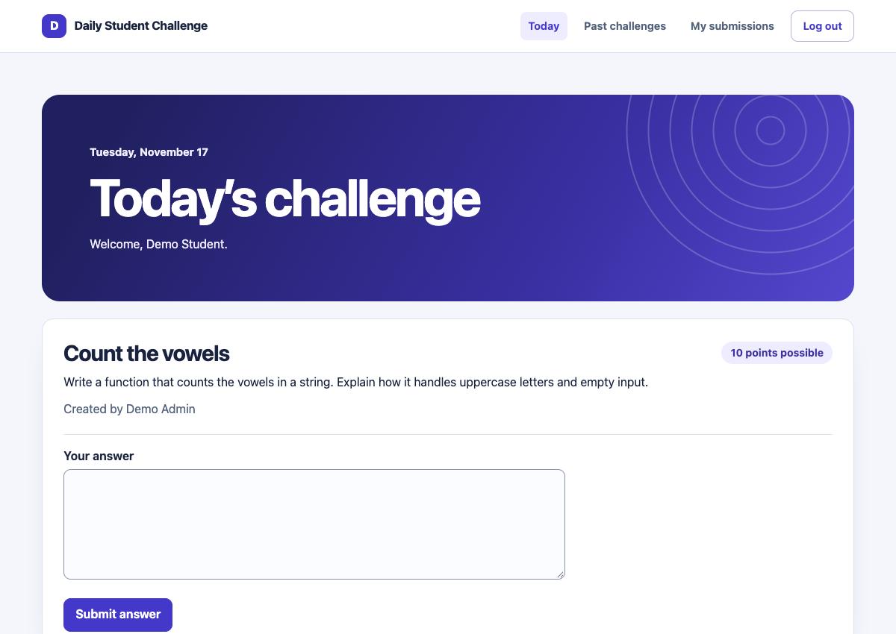
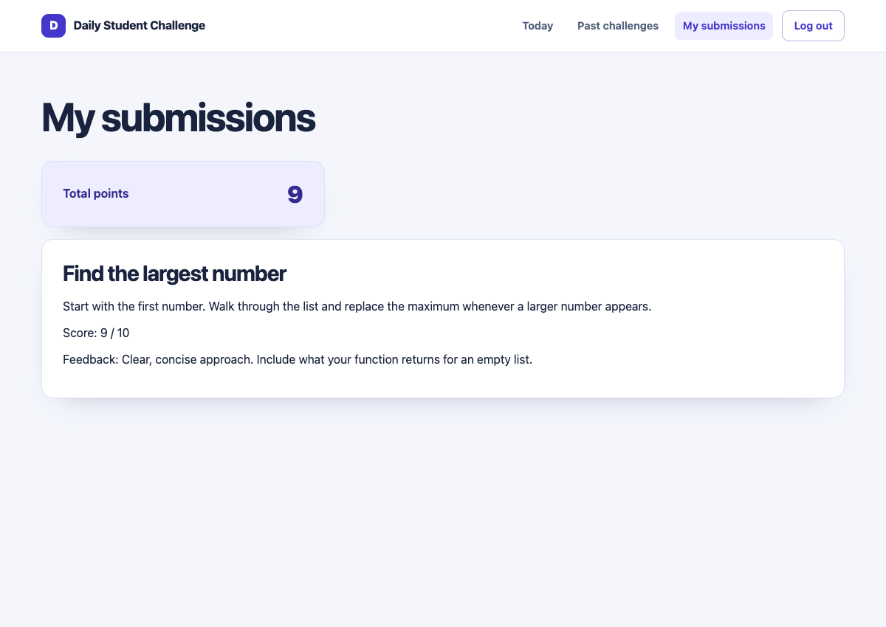
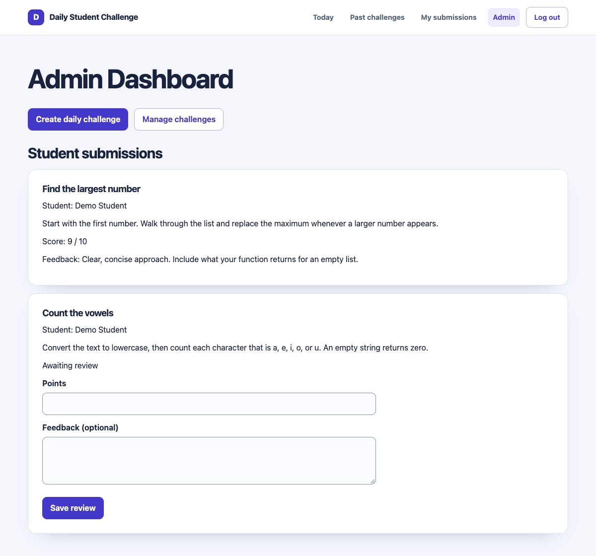

# Daily Student Challenge

A Laravel practice project where students answer one challenge per day and get feedback from an admin. I built it to practice authentication, role-based access, relational data, and server-rendered interfaces.

## What you can do

- **Student:** Register, sign in, submit one answer to today's published challenge, and browse past challenges. The student dashboard shows pending reviews, scores, feedback, and total points.
- **Admin:** Create one challenge per date, manage drafts and published challenges, and review answers. Scores range from zero to the challenge's maximum points.

**Stack:** Laravel 13, PHP, Blade, CSS, and MySQL.

## Screenshots

The screenshots use fictional demo accounts and submissions.

| Today's challenge | Student dashboard | Admin review |
| --- | --- | --- |
| [](docs/screenshots/today.png) | [](docs/screenshots/student.png) | [](docs/screenshots/admin.png) |

## Automated checks

[GitHub Actions](https://github.com/Ye-Khant21/daily_student_challenge/actions/workflows/tests.yml) runs the PHPUnit suite on pushes and pull requests using an in-memory SQLite database. Run the same suite locally with `vendor/bin/phpunit`.

## Run locally

You'll need PHP 8.4 or later, Composer, and a running MySQL server. The Blade pages load their stylesheet directly, so there's no frontend build step.

```sh
git clone https://github.com/Ye-Khant21/daily_student_challenge.git
cd daily_student_challenge
composer install
cp .env.example .env
php artisan key:generate
```

Create an empty MySQL database named `daily_student_challenge`. Set these values in your local `.env`, using your own MySQL username and password.

```dotenv
DB_CONNECTION=mysql
DB_HOST=127.0.0.1
DB_PORT=3306
DB_DATABASE=daily_student_challenge
DB_USERNAME=your_mysql_user
DB_PASSWORD=your_mysql_password
```

```sh
php artisan migrate
php artisan db:seed --class=ChallengeSeeder
php artisan serve
```

Open [http://127.0.0.1:8000](http://127.0.0.1:8000). The seeder creates today's sample challenge and fills in missing dates from the previous five days. Challenge dates follow the app's `Asia/Kolkata` timezone.

## Try the review workflow

1. Register two local accounts, one for the student and one for the admin.
2. Promote your test admin in Tinker. Replace the email below with the exact email you registered for that account.

   ```sh
   php artisan tinker
   ```

   ```php
   $admin = \App\Models\User::where('email', 'admin@example.com')->firstOrFail();
   $admin->role = 'admin';
   $admin->save();
   exit
   ```

3. Sign in as the student, submit an answer to today's challenge, and open **My submissions** to see it awaiting review.
4. Sign in as the admin, open **Admin**, and award points and feedback.
5. Return to **My submissions** as the student to see the review and updated total.
